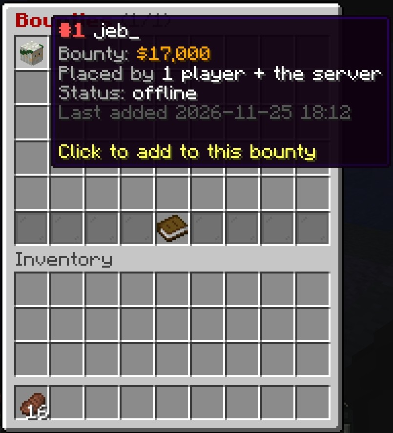
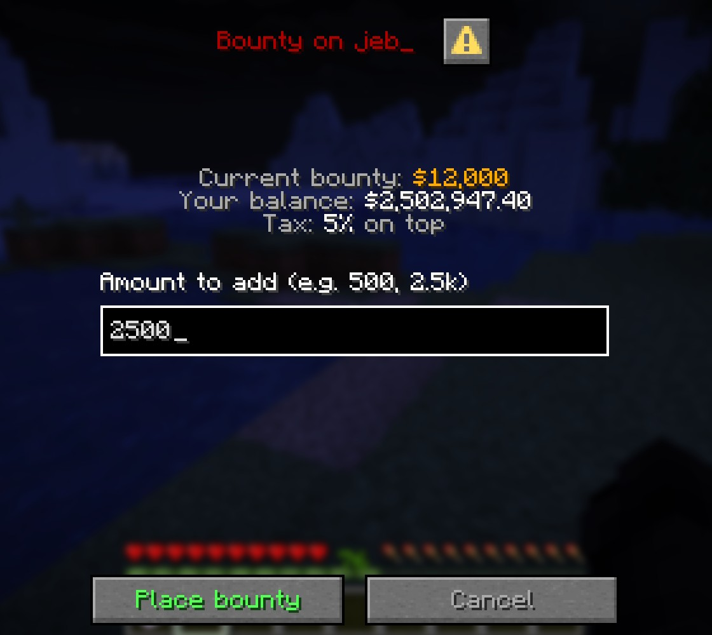
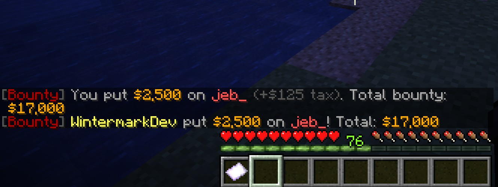
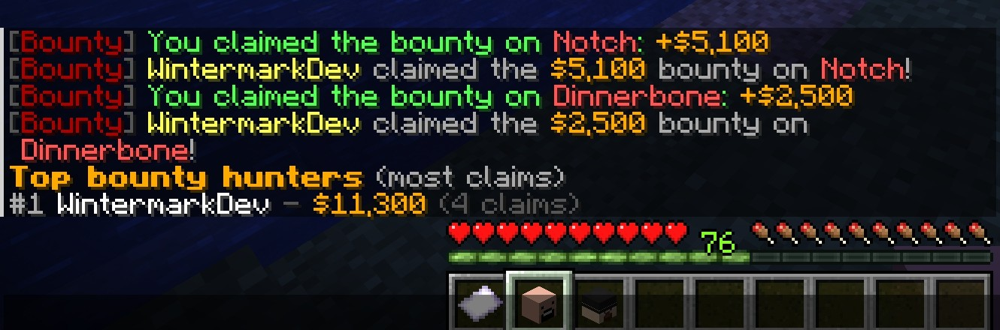
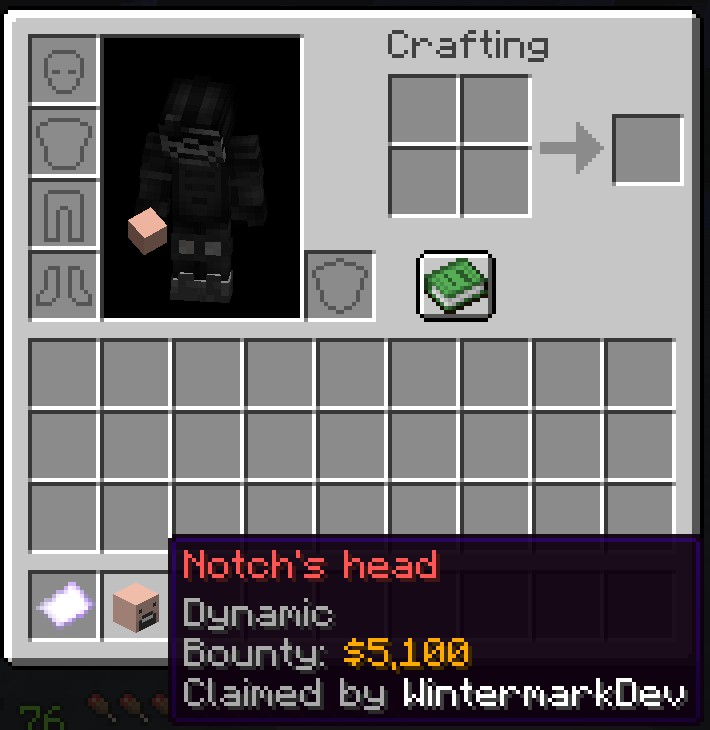
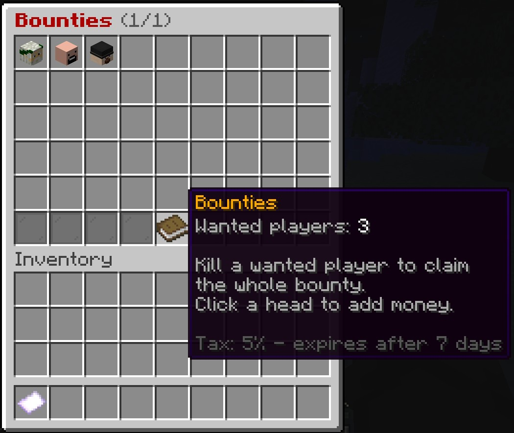

# Wintermark Bounties

**Player bounties for Paper servers: put money on someone's head, and whoever kills them collects it.**
A head menu of every wanted player, stacking bounties, head drops, top hunters, auto bounties on killing sprees and anti-abuse rules built in.



## Features

- **Bounty menu.** `/bounty` shows every wanted player as a head, biggest bounty first, with the amount, who paid in and whether they are online. Click a head to add money.
- **Native amount dialog.** Adding money opens Minecraft's own text-input screen with the current bounty, your balance and the tax. No chat typing.
- **Stacking bounties.** Any number of players can add to the same bounty. Every contribution is tracked per player.
- **Claims with a trophy.** Killing a wanted player pays the whole bounty to the killer, drops the target's head with "Bounty $X - claimed by Y" and tells the whole server.
- **Top hunters.** `/bounty top` ranks players by claims or by money earned.
- **Auto bounties.** Players who kill too many players in a short time get a bounty from the server (3 kills in 10 minutes by default, stacking per extra kill).
- **Anti-abuse.** No payout when killer and target share an IP (alt accounts), contributors can't claim their own bounty, a minimum amount, a placing cooldown and an exempt permission for staff.
- **Tax and expiry.** An optional tax on top of each bounty as a money sink. Shares expire after 7 days and go back to the players who paid them.
- **Works with any economy.** Uses [Wintermark Economy](https://github.com/wintermarkinteractive/WintermarkEconomy) directly, or any Vault economy (EssentialsX, CMI...).
- **Fully configurable.** Every amount, rule, menu text and message (MiniMessage colors). New settings are added to your config automatically on updates.

| Add money through a dialog | Placed, with tax and a broadcast |
|---|---|
|  |  |

| Claim: payout, broadcast and top hunters | The target's head as a trophy |
|---|---|
|  |  |



## The Wintermark Economy Suite

Three plugins built to work together, each one usable on its own:

| Plugin | What it does |
|---|---|
| [Wintermark Economy](https://github.com/wintermarkinteractive/WintermarkEconomy) | The money: balances, payments, banknotes, history |
| **Wintermark Bounties** | Put money on other players' heads, claim it with a kill |
| [Wintermark Auctions](https://github.com/wintermarkinteractive/WintermarkAuctions) | Auction house with categories, search and a collection box |

With Wintermark Economy installed, every bounty payment shows up in `/money history` as BOUNTY.

## Requirements

- **Paper 26.3** (or a Paper fork such as Purpur) with **Java 25**
- An economy: [Wintermark Economy](https://github.com/wintermarkinteractive/WintermarkEconomy) (recommended), or [VaultUnlocked](https://modrinth.com/plugin/vaultunlocked)/Vault + any economy plugin
- Not tested on Folia or Spigot

## Installation

1. Install an economy (see above).
2. Download `WintermarkBounties-1.0.0.jar` and put it in your server's `plugins` folder.
3. Start the server. `plugins/WintermarkBounties/config.yml` and `bounties.db` are created.
4. Check the console: it says which economy was found. Without one, the plugin turns itself off.

## Commands

Main command `/bounty`, alias `/bounties`.

| Command | Description | Permission |
|---|---|---|
| `/bounty` | Open the bounty menu | `wintermark.bounty.use` |
| `/bounty set <player> <amount>` | Place or add to a bounty (also `add`, `place`) | `wintermark.bounty.place` |
| `/bounty check [player]` | See a bounty (your own without a name) | `wintermark.bounty.use` |
| `/bounty top [claims\|earned]` | Top bounty hunters | `wintermark.bounty.use` |
| `/bounty give <player> <amount>` | Server-paid bounty (event prizes, works from the console) | `wintermark.bounty.admin` |
| `/bounty remove <player> [norefund]` | Remove a bounty, refunding every contributor | `wintermark.bounty.admin` |
| `/bounty forceclaim <target> <killer>` | Pay a bounty out by hand (e.g. after a bugged death) | `wintermark.bounty.admin` |
| `/bounty reload` | Reload `config.yml` | `wintermark.bounty.admin` |

**Permissions**

| Permission | Default | Description |
|---|---|---|
| `wintermark.bounty.use` | everyone | Menu, check, top |
| `wintermark.bounty.place` | everyone | Place bounties with your own money |
| `wintermark.bounty.admin` | op | Server bounties, remove, force claim, reload |
| `wintermark.bounty.bypass.cooldown` | nobody | No waiting time between placing bounties |
| `wintermark.bounty.exempt` | nobody | Nobody can place a bounty on this player (e.g. staff) |

## Configuration

The default config is commented line by line. The main sections:

```yaml
min-amount: "100"
tax-percent: 5                 # paid on top by the placer; 0 = no tax
place-cooldown-seconds: 30

anti-abuse:
  block-same-ip: true          # no payout for alt accounts; the bounty stays open
  contributors-can-claim: false

expiry:
  days: 7                      # each share is refunded after this; 0 = never

auto-bounty:
  enabled: true
  kills: 3
  minutes: 10
  amount: "1k"
  stack-per-kill: true

broadcast:
  place: true
  place-min: "0"               # only broadcast bounties of at least this amount
  claim: true

head-drop:
  enabled: true
  name: "<red><target>'s head"
  lore: ["<gray>Bounty: <gold><amount>", "<gray>Claimed by <white><killer>"]

menu:                          # titles, head lore, buttons
dialog:                        # the amount input screen
messages:                      # every message
```

Text uses [MiniMessage](https://docs.advntr.dev/minimessage/format.html). Set any message to `""` to turn it off.

## FAQ

**My friend and I play from the same house and claims don't pay out.**
That's the same-IP protection against alt accounts. Set `anti-abuse.block-same-ip: false` if you trust the players on your network.

**What happens to a bounty that nobody claims?**
Each player's share expires `expiry.days` after they last added to it and goes back to them. Server-paid shares just disappear.

**Does the tax come off the bounty?**
No, it is paid on top. A $1,000 bounty with 5% tax costs the placer $1,050 and the target is worth the full $1,000.

**Where is data stored?**
`plugins/WintermarkBounties/bounties.db` (SQLite): open bounties with every contribution, and all claims for the top list.

## Building from source

```
git clone https://github.com/wintermarkinteractive/WintermarkBounties.git
cd WintermarkBounties
./gradlew build
```

The jar is in `build/libs/`. Requires JDK 25. Put the VaultUnlocked jar in `libs/` first (see `libs/README.md`); the jars there are only used to compile the economy bridge.

## License

[MIT](LICENSE)

---

**Wintermark Interactive** - game mods, plugins and systems.
Designed, tested and maintained by Wintermark Interactive.
Custom plugins and server setups: wintermarkinteractive@gmail.com
